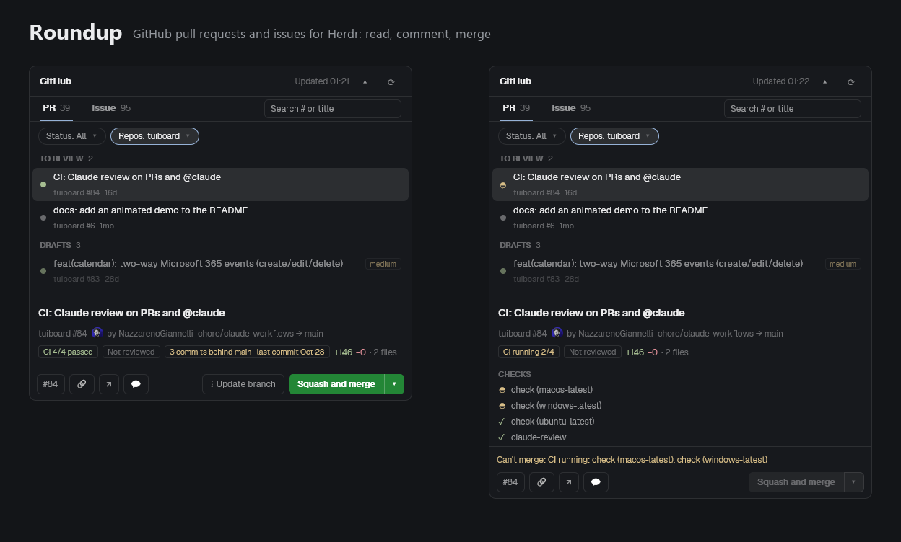

# Roundup

GitHub pull requests and issues for Herdr: read, comment, merge.



Roundup is a panel for the [Herdr](https://herdr.dev) desktop app. It lists the open pull requests and issues of the GitHub users and organizations you pick, across all their repositories at once. Select one to read its description and conversation, with its commits, checks and reviews. A one-row bar under the detail copies the number or URL, opens the page on GitHub, posts a comment, brings a branch that fell behind up to date, and merges with a split button like GitHub's (two clicks: the first arms it, the second merges). Two dropdowns above the list, Status and Repos, narrow it down. Well down a long thread, a round `↑` in the detail's corner takes you back to the top. It talks to GitHub through the `gh` command line tool, so there is no token to paste and nothing to download.

Pull requests are grouped by whose move it is: ready to merge, to review, needs fixing, waiting for CI, drafts. When CI blocks a merge, the bar names the checks that failed or are still running.

It works across many repositories and owners, and keeps your branching rules if you use a `staging` branch (see [Merging](#merging)).

Roundup does not close or reopen anything, does not review or approve, and does not edit labels. Merged pull requests are read-only.

## Install

1. Copy `mods/roundup` and `mods/roundup-dry` into `~/.config/herdr-app/mods/`.
2. Add `roundup` to a layout, for example as a block in the right column. In `layouts/<name>.json`:
   ```json
   { "id": "github", "type": "block", "content": { "mod": "roundup" } }
   ```
   If the column is a stack, add it as one more child.
3. Optional: copy `mods/roundup/config.example.json` to `mods/roundup/config.json` and edit it (see [Configuration](#configuration)).
4. Run `herdr-app check ~/.config/herdr-app/mods/roundup` and the same for `roundup-dry`.

The folder names matter: the panel finds itself in the layout by the name `roundup`, and the dry-run popup shares keys with it. The folder must be named `roundup` (the name is used for its shared keys and popups).

## Requirements

- [`gh`](https://cli.github.com), signed in (`gh auth status`). Everything is read and written through it.
- `curl`, for profile pictures. Windows 10+ and most Linux systems have it. Without it the panel shows initials instead.

The panel reaches GitHub's API (through `gh`) and `avatars.githubusercontent.com` (through `curl`). It saves the pictures under `data/roundup/avatars/` in Herdr's home folder and remembers the list height in the app's local storage. It reads `config.json` from its own folder and nothing else.

## Configuration

An optional `mods/roundup/config.json`. Every field is optional. The panel reads the file when it starts. Herdr reloads a mod when any file in its folder is saved, `config.json` included, so a saved change applies on its own; if it does not, restart the app.

| Field | Default | What it does |
| --- | --- | --- |
| `owners` | your login and your organizations | GitHub users or organizations whose open pull requests and issues are listed. Empty or missing: looked up once per run with `gh api user` and `gh api user/orgs`, so the list covers your own repositories and every organization you belong to. Set `owners` to narrow it. |
| `stagingFlow` | `false` | `true` follows a feature branch, `staging`, `main` flow when choosing the default merge method (see [Merging](#merging)). `false` uses what each repository did last. |
| `labels.ready` | `[]` | Labels that put a pull request in the Ready to merge group, on top of the built-in signal (CI passing and approved). |
| `labels.review` | `[]` | Labels that put a PR in the To review group even after someone has commented, for example a label your review bot adds while a review round is open. Without them, To review means nobody has reviewed it yet. |
| `labels.deps` | `["dependencies"]` | Labels that mark a pull request as a dependency update (what the Dependencies box picks), on top of pull requests opened by Dependabot or Renovate (matched by login, with or without `[bot]` or `app/`). |
| `reviewers` | `[]` | Logins whose comments are highlighted as the reviewer's (accent border, a "reviewer" chip). The convention: a listed reviewer's latest comment counts as an approval unless it starts with `CHANGES REQUESTED`. With none listed, only GitHub's own review decision counts. Example for people who run Claude's code review: `["claude"]`. |
| `mergedDays` | `7` | How many days the Merged status looks back. A whole number from 1 to 365. |

By default the list covers your own repositories and every organization you belong to; in a large organization its 100 most recently updated open pull requests can crowd out your own, so set `owners` to narrow the list. A list you give replaces the default (`"deps": []` turns the `dependencies` label off). Labels and logins are compared without regard to case. Names starting with `_` or `$` are ignored, so you can leave notes in the file.

Example:

```json
{
  "owners": ["your-login", "your-organization"],
  "stagingFlow": false,
  "labels": {
    "ready": ["ship-it"],
    "review": ["needs-review"],
    "deps": ["dependencies"]
  },
  "reviewers": ["claude"],
  "mergedDays": 7
}
```

If the file is missing, the defaults apply and nothing is said. If it cannot be read, is not valid JSON, or a field is wrong, the panel shows one line, `config.json: <problem>, using defaults`, and uses the default for what it could not use. Unknown fields are reported too, to catch typos.

If GitHub answers a list with results and an error as well (an organization that needs SSO authorization for your `gh` token, for example), the results are shown and an amber line says `Some results may be missing: <GitHub's message>`. If it answers with an error and no results, the list fails and says why.

## Using it

- **Tabs:** PR and Issue, each with its total.
- **Filters:** two dropdowns under the tabs, `Status: ... ▾` and `Repos: ... ▾`. Both open a list of checkboxes that stays open while you tick; each tick applies at once, and Esc or a click outside closes it. The choice is remembered across restarts.
  - **Status** (PR tab only) works like Repos: `All` is ticked until you tick something, and then the list shows only what you ticked. The boxes are the five groups with their counts (Ready to merge, To review, Needs fixing, Waiting, Drafts), `Dependencies` (dependency updates from any group) and `Merged (last 7 days)`. Several boxes add up: `Needs fixing` plus `Dependencies` shows both. Ticking all five groups is the same as All. Merged is a list of its own: ticking it clears the other boxes, ticking anything else leaves it. The button reads `Status: All`, `Status: Merged`, the name of the one box ticked (`Status: Drafts`), or how many (`Status: 2`).
  - **Repos** (both tabs) has `All` and every repository of the list with its count, most items first. Tick as many as you like; nothing ticked means all. A ticked repository with nothing left in the list stays in the menu, greyed with 0, so you can untick it. The button reads `Repos: All`, `Repos: widgets`, `Repos: gadgets, widgets` or `Repos: 3`.
- **Groups:** while you are not searching (and not on Merged), pull requests sit under headings in this order: Ready to merge, To review, Needs fixing, Waiting, Drafts. A pull request is in the first group that fits. Drafts are always last. Empty groups are hidden.
- **Dots:** green CI passing, red failing, amber running, grey none, purple merged.
- **Refresh:** the list reloads every minute while the panel is on screen (every 30 seconds while a CI runs). `⟳` reloads now. `▴` hides the list so the detail gets the whole panel, `▾` brings it back (so do `Ctrl+F` and `/`). Both buttons have a tooltip. Drag the bar between list and detail to resize.
- **Keys:**
  - `↑` / `↓` move through the list.
  - `Ctrl+F` (or Cmd+F) focuses the search field from anywhere in the panel. `/` does the same when the list has the keyboard.
  - `Esc` cancels an armed merge, then clears the search; a second `Esc` leaves the field.
  - In the search field, `↓` goes to the results and `Enter` selects the first one. For a number with no match, `Enter` opens it on GitHub.
  - `Ctrl+Enter` sends a comment, `Esc` closes the box and keeps the text.
- **Search:** `130` or `#130`, `widgets#130`, `acme/widgets#130`, or words from the title, repository or labels. It covers the whole tab and ignores the filters; clearing it brings the filtered list back.

## Following CI


Left, a branch that fell behind its base, with **Update branch** next to the merge button. Right, the same pull request after the update: its CI runs again and the panel follows it.

- **In the list**, a pull request whose CI is running shows an amber circle that turns where its dot would be.
- **In the detail**, a `CHECKS` list names each check: failed first (✗), then running (the turning circle), then queued (○), then the rest (✓). Each row says how long the check took, or for how long it has been running; a click opens its run on GitHub. While something runs or has failed the list is open. When everything passed it is one line, `CHECKS · 6 passed · 1 skipped`, that opens on a click.
- **Reviews.** Under the checks, `REVIEW` lists who is reviewing and where each one stands: a review check running (`claude-review`, `security-review`: any check with "review" in its name, shown as that reviewer when it starts with a login in `reviewers`), someone asked for a review who hasn't given it yet, then each person's latest verdict (approved, requested changes, commented). For a login in `reviewers`, their latest comment counts too, as it does for the groups.
- **Commits.** The `ACTIVITY` thread has the branch's commits (the last 100) among the comments and reviews, in order. Commits in a row by the same author become one line, `jonas pushed 4 commits · 2h`, that opens on a click; the newest push starts open. Each commit shows its CI mark, short hash and title, and a click opens it on GitHub. Force pushes show as one line.
- **How live it is.** GitHub can't push to a panel on your machine, so Roundup looks again: the selected pull request every 10 seconds while one of its checks runs, the list every 30 seconds while any pull request in it has CI running, and every minute otherwise. When the checks finish, the list is read again so the row's dot catches up.

## Merging

- **Two clicks.** The first click arms the button and it asks to confirm. The second merges. Esc, a click elsewhere or selecting another item cancels. A second click within half a second of the first is ignored.
- **Checked again.** Just before merging, the panel reads the pull request once more. If CI, conflicts, draft state, the head commit or the base branch changed since you armed the button, it stops and says why.
- **Pinned to the head commit.** Every merge passes `--match-head-commit`, so GitHub refuses it if the branch moved. If the pull request's head commit can't be read, nothing is merged and the bar says so.
- **Flags it never uses:** `--admin`, `--auto` or `--delete-branch`. Branch deletion is the repository's own setting.
- **Drafts:** the button says "Mark ready and ...". Confirming runs `gh pr ready`, then the merge.
- **Why it can't merge:** the note beside the button gives the reason, with the checks named: `Can't merge: CI failing: test, build` (three names, then `+N more`), `CI running: e2e`, has conflicts, blocked by branch protection.
- **A branch that fell behind.** For the selected pull request the header says how far its branch is behind the base and when its last commit was made (`15 commits behind staging · last commit Oct 23`): a green CI that old was run against an old base. `⇣ Update branch`, next to the merge button, merges the base into the branch, like GitHub's own button, and CI runs again. Two clicks, as for a merge. It never rebases, and it pins the head commit (`expected_head_sha`), so GitHub refuses it if the branch moved. Not shown for drafts, branches with conflicts, or Dependabot and Renovate pull requests (they keep their own branches up to date).
- **Which method.** The big button uses the default method; the `▾` lists squash, merge commit and rebase, with the ones the repository's settings or branch rules forbid greyed out. A pick applies to that pull request only.
  - `stagingFlow` off (the default): the method the last merged pull request into the same base branch used, else squash. For a rebase the history looks like a squash, so it shows as squash.
  - `stagingFlow` on: for repositories with feature branches going into `staging`, then `staging` into `main`. A back-merge (`main` into `staging`), a branch named `backmerge/...` and `staging` into `main` are merge commits, so history stays shared. In a repository with a `staging` branch, other pull requests into `main` are merge commits and the rest are squashed. A repository without one follows history.

## Dry run

Open the `roundup-dry` mod (`mod.open roundup-dry`; bind a free key to `mod.open:roundup-dry` in `keys.json`). A small popup shows whether dry run is now on or off and closes itself. While it is on, merging and commenting run nothing: the `gh` commands that would have run are written to the shared key `roundup.dryLog` (the last 50), and the bar says "Dry run — nothing will be merged". Open it again to turn it off.

## Tests

The logic that does not need Herdr is plain JavaScript with tests:

```sh
cd mods/roundup
node --test
```

## Development

Herdr reloads a mod on every save and keeps the old build in memory. Edit a scratch copy, copy all changed files in at once, and restart the app every few dozen saves.

## Platforms

Tested on Windows 11. Linux is not confirmed: it needs only `gh` and `curl`, so it should work, but it has not been tried. macOS has not been tried.

## Author

Nazzareno Giannelli. MIT license, see `LICENSE`.
