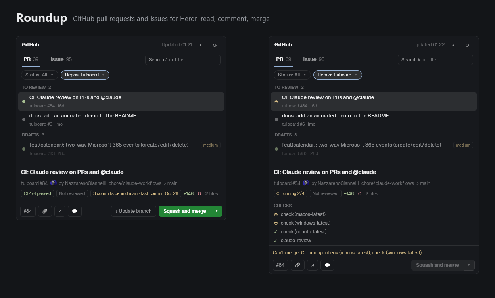

# Roundup

A panel for the right column of the Herdr window. It lists the open pull requests and issues of the GitHub users and organizations you work with, all repositories at once. Pick one and its description and conversation open below the list, with a bar of actions at the bottom: copy the number or URL, open it on GitHub, comment, and merge with a green split button like GitHub's. Pull requests are grouped by whose move it is. A second small mod, `roundup-dry`, turns a dry run on and off so merges and comments can be tried without sending anything.

## What you see

One rounded panel (radius 10, 1px `border`, `background` fill, 13px text in `foreground`) filling its block. Top to bottom:

1. **Header**, 42px, 14px side padding, 1px line under it. "GitHub" in semibold on the left. To its right, in 11.5px `dim`, right-aligned and truncated: `Updated HH:MM` of the last good load of the list in view. Then two 28x26 icon buttons, each with a tooltip: `▴` (tooltip `Hide the list`; folded it shows `▾`, tooltip `Show the list`, highlighted with `selected`) and `⟳` (tooltip `Refresh`; a 14px braille spinner while a fetch is running, tooltip `Refreshing…`).
2. **The list area**, a fixed height: the saved one, else 45% of the panel; always between 80px and 60% of the panel. It holds, top to bottom:
   - **Tabs row**: `PR` and `Issue`, 34px high, semibold, each followed by its total in 11.5px `dim` (an en dash until loaded). The active tab is `foreground` with a 2px `accent` underline, the other `muted`. At the right end a search field, 190x26, 6px radius, 1px `border` (`accent` while typing), 12px text, placeholder "Search # or title", with a `×` clear button when it has text.
   - **Filter row** (not while searching; once the tab's list has loaded): two dropdown buttons, 24px high, 12px radius, 11.5px text, 10px side padding, then a `dim` `▾`: `Status: ... ▾` (PR tab only) and `Repos: ... ▾`. A button that narrows the list (Status not `All`, or any repository chosen) has an `accent` border and `selected` fill. Labels: `Status: All`, `Status: Merged`, the one ticked box by name (`Status: Drafts`, `Status: Dependencies`), `Status: 2` (more); `Repos: All`, `Repos: widgets`, `Repos: gadgets, widgets` (two, by name), `Repos: 3` (more).
   - **Notes**, 11.5px: while searching, `N results · Esc to clear`; a red line (`ansi1`) when a list failed to load, `Couldn't load pull requests: <message> · showing the last list`; an amber line (`ansi3`) for a config problem, `config.json: <problem>, using defaults`; an amber line `Some results may be missing: <message>` when GitHub answered a search with results and an error; a `dim` line `Showing 100 of 140 open pull requests` when GitHub has more than the 100 fetched.
   - **The rows**, a virtual list with a scrollbar. A pull request row is 46px high, 10px side padding, radius 7: an 8px round dot, then the title (truncated) over a second line in 11px `dim`, `<repo> #<number>` and its age (`now`, `5m`, `2h`, `3d`, `2mo`, `1y`; for merged ones `merged 2h`). The dot is `ansi2` for CI passing, `ansi1` failing, `ansi3` running, `dim` for no CI, and `#8957e5` for a merged one. A pull request with a `priority-high`, `priority-medium` or `priority-low` label shows that word as a small chip beside the title (`ansi1`, `ansi3`, `dim`). Drafts are drawn at 55% opacity. The selected row is on `selected`, the hovered one on `hover`.
   - **Group headings** (PR tab, not on Merged, not while searching): 28px rows, 10px padding, 11px semibold uppercase `dim` text, then the count in normal weight: `READY TO MERGE 3`. Not clickable.
   - An issue row has no dot colour (an empty 8px spacer keeps the titles aligned) and shows all its labels as 10px chips that wrap onto more lines; the row grows with them.
   - Empty states, 12px `dim`: `Loading…`, `Press ⟳ to retry.`, `No open pull requests`, `No pull requests match these filters` (`No issues match these filters`), `No pull requests merged in the last 7 days`, `Nothing matches “<text>” · Esc to clear`, `No open #130 · Esc to clear` (with an "Open on GitHub ▾" pill when it is a bare number).
3. **Divider**, 9px, a 1px `border` line in the middle (3px `accent` while dragged), row-resize cursor.
4. **Detail**, filling the rest, scrolling, 12px padding, 12px between blocks:
   - Title, 14px semibold. A line of 11.5px `dim`: `<repo> #<n>`, a 16px avatar and `by <login>`, a `Draft` chip, `<head> → <base>`.
   - For a merged pull request: a purple (`#8957e5`) chip `Merged · merge commit` or `Merged · squash` or `Merged`, then `by <login> · <time> ago`.
   - Chips (18px high, 10.5px text, 1px `border`): the CI state (`CI 3/3 passed` in `ansi2`, `CI failed: build, lint, e2e +2 more` in `ansi1`, `CI running 1/3` in `ansi3`, `No CI` in `dim`, or before the detail loads `CI passing` / `CI failing` / `CI running`); the review state (`Approved` or `Reviewed` green, `Changes requested` red, `Not reviewed` dim); `Has conflicts` in `ansi1`; then `+60 −3 · 3 files` with the numbers in `ansi2` and `ansi1`. Then the labels as chips.
   - The description as selectable markdown, 12.5px. Empty: `No description provided.` Cut: `Description truncated · Open on GitHub`.
   - `ACTIVITY` (11px semibold `dim`), then the conversation, oldest first: comments and reviews as bordered cards (8px padding, radius 7, 22px avatar, author in semibold, a state word for reviews such as `approved`, the age), label events as one dim line `<who> added the label <name> · <age>`. The last 50 entries show; `Show earlier (n)` reveals the rest. A reviewer's card has a 2px `accent` left border, `selected` fill, an accent name and a `reviewer` chip. Older bodies past the reading budget collapse to a one-line excerpt with a `Show` link.
   - While loading: a braille spinner and `Loading…`; on failure `Couldn't load the details: <message> · Press ⟳ to retry.` in `ansi1`.
5. **Action bar**, under the detail, 1px line above it, 10px side and 8px vertical padding, 8px between its lines:
   - On a dry run: `Dry run — nothing will be merged` in `ansi3`, 11.5px.
   - The comment box when open: a textarea that grows from 3 to 10 lines, a `Ctrl+Enter to send · Esc to close, the text is kept` line and a `Send` button.
   - A failure notice for the selected item, `ansi1` (error) or `ansi3` (warning), 11.5px.
   - For a pull request that is not merged, a note line, 11.5px, only when there is something to say: `Checking the pull request…`, `Can't merge: CI failing: test, build`, `Click again to confirm · Esc to cancel`, `Click again to merge staging into fix/x · Esc to cancel` (an armed update).
   - One row, wrapping when it doesn't fit: the buttons on the left, 28px high, 6px radius, 1px `border`, 12px `muted` text, compact so the right side has room: `#130` (copies `owner/repo#130`), then three icon buttons at least 28px wide with a tooltip: `🔗` (copy the link), `↗` (open on GitHub) and `💬` (comment, not for a merged pull request). On the right (`ml_auto`), for a pull request that is not merged: `⇣ Update branch` when the branch is behind its base (same look as the left buttons; armed: `background` fill, `ansi3` border and text, label `Confirm update`), then the merge button. A long label that doesn't fit wraps the right side onto its own line.

**The merge button** is two joined parts, 28px high, 6px outer radius. The label part is semibold 12px, 12px padding; then a 28px wide `▾` part. Green (`#238636`, `#2ea043` on hover, white text, a `#ffffff40` line between the parts) when the pull request can go in as it is. Neutral (`hover` fill, `border`, `foreground`) for a draft. Armed: `background` fill, `ansi3` border and text. Off: `hover` fill and `dim` text. The `▾` part is half transparent when there is nothing to choose.

**Popups**, `popover` fill, 12.8px text, rows 31px high with 8px padding, the selected row on `selected`:
- **Status**: 270px wide. Rows of 31px with a 14px checkbox (rounded 3px, `accent` border and a `✓` when ticked, `dim` border when not), the label, and the count in 11.5px `dim`: `All`, the five groups in group order with their counts, a 1px `border` line (9px with its margins), `Dependencies` with its count, another line, `Merged (last N days)` with its count once that list has loaded. `All` is ticked while nothing else is; every row can be ticked.
- **Repos**: 260px wide, at most twelve rows high, then a scrollbar. `All`, then one checkbox row per repository (short name, count), most items first, ties by name. A ticked repository with no items is at 60% opacity with a 0.
- Both stay open while you tick. `↑`/`↓` move over the enabled rows, `Enter` or `Space` ticks, `Esc` or a click outside closes.
- **Open on GitHub**: 300px wide, one row per `owner/repo` with `↗`.
- **Merge methods**: 300px wide, opens upward from the arrow. One row per method (`Squash and merge`, `Create a merge commit`, `Rebase and merge`), a `✓` on the current one, a dim reason line under a disabled one (`Disabled in this repository's settings`, `Not allowed on this branch`), and a footer after a line: `The default is what this repository usually does; your pick applies to this PR only.`

**Dry-run popup** (`roundup-dry`): a 400x40 popup at the top centre, 44px down, no frame: an 8px radius, 1px border and 13px text, `GitHub dry run ON · nothing is merged or posted` in `ansi3` (border too), or `GitHub dry run OFF · merges and comments are real` in `foreground`.

## How it behaves

**Loading.** The panel fetches only while it is on screen: its block is in the layout, no column above it is hidden, and every stack above it shows it. A cheap check every 3 seconds notices when it was just shown and reloads; while shown it reloads once a minute. A reload keeps the rows where they were (the order only resets on a tab or filter change, the ⟳ button or the panel being shown again, then newest-updated first). A failed reload keeps the last list and shows the red line. The Merged list is fetched only while the Merged status is ticked.

**Selecting.** Clicking a row, or `↑`/`↓` while the list has the keyboard, selects it and loads its detail (one at a time, so holding `↓` loads only where you stop). A detail is cached for the session (15 kept) and loads again when the list says the item changed. Headings are never selected; the arrows step over them and the list scrolls to keep the row in view.

**Groups.** Each pull request is in exactly one, first match wins: Drafts if it is a draft (always last); Ready to merge if CI passes and it is approved, or it has a `labels.ready` label; To review if nobody has reviewed it and CI is not failing; Needs fixing if CI fails or changes were requested; Waiting if CI is running; anything left (approved, no CI) goes to Ready to merge. "Approved" is GitHub's decision, or else the newest comment by a configured reviewer that does not start with `CHANGES REQUESTED`.

**Filters.** One state, `{ v: 2, groups, deps, merged, repos }`, shared by both tabs; `groups`, `deps` and `merged` apply to the PR tab only. Both menus work the same way: nothing ticked means all, and what is ticked is what is shown, several ticks adding up. `groups`: the groups picked (none: every open PR; all five collapse to none). `deps`: picks the dependency PRs of every group, added to the picked groups; a dependency PR has the author `dependabot` or `renovate` (GitHub's GraphQL logins; `dependabot[bot]` and `app/renovate` match too), or a `labels.deps` label (default `dependencies`). `merged`: exclusive, shows the pull requests merged in the last `mergedDays` days, newest first, read-only, as one flat list, and is exclusive: ticking it clears `groups` and `deps`, ticking a group or Dependencies clears it, unticking it is All. A state saved without `v: 2` (the first version, whose boxes hid what was unticked) keeps its repositories and Merged and starts the status from All. `repos`: the repositories shown, none meaning all; it applies to the open PRs, the Merged list and the issues. The numbers in the Status menu follow the chosen repositories; the numbers in the Repos menu are the whole list's. A group heading's count and the empty states follow the filters. The state is written to the shared key `roundup.filters` (`{ ...state, at }`) by the popups, read by the panel in render, and kept in `localStorage` under `roundup.filters`; unknown groups and garbage are dropped when it is read, a repository that no longer exists is kept (it shows greyed with 0).

**Search.** The field covers the whole tab and ignores the filters (they come back when it is cleared). `130` or `#130`: the exact number first, then numbers starting with it, then titles containing it. `widgets#130` or `acme/widgets#130`: that repository (prefix match on the short name); `widgets#` alone narrows to the repository. Anything else: every word (split on spaces and dashes) must be in the title, repository or a label, newest first. `Ctrl+F` (Cmd+F) anywhere in the panel focuses it; `/` does when the list has the keyboard. `Esc` clears the text; an empty field gives the keyboard back. `↓` moves into the results; `Enter` selects the first. With no match for a bare number, `Enter` opens it on GitHub (straight away when one repository could have it, otherwise in the "Open on GitHub" popup).

**Comment.** `💬 Comment` opens the box and focuses it. `Ctrl+Enter` posts through `gh pr comment` or `gh issue comment`. `Esc` closes it and keeps the text for that item. Over 30,000 characters is refused before `gh` is called. On success a toast says `Comment posted on owner/repo#130` and the thread reloads.

**Merge.**
- Idle: the label shows what a click will do: `Squash and merge`, `Merge pull request`, `Rebase and merge`, or for a draft `Mark ready and squash and merge` (and so on).
- First click: arms it. The label becomes `Confirm squash and merge` (amber), the note says `Click again to confirm · Esc to cancel`. A second click within 500 ms is ignored. Esc, a click elsewhere, picking another item, opening the `▾` popup, or anything that changes the label cancels.
- Second click: the button reads `Merging…`. The panel loads the pull request again and stops with a warning toast and a note kept in the bar if CI is failing or running, there are conflicts, branch protection blocks it, it became a draft or stopped being one, new commits arrived, or the head or base branch changed. If only mergeability is unknown it waits 2.5 s and looks once more. If the fresh pull request has no head commit it stops with `Couldn't read the head commit of this pull request, so nothing was merged...` and runs nothing. Otherwise it runs `gh pr merge <n> --repo <repo> --squash|--merge|--rebase --match-head-commit <sha>`, after `gh pr ready <n> --repo <repo>` for a draft. A failure shows `Couldn't merge: <gh's message>`; a merge that fails after marking ready says `Marked ready, but the merge failed: ...`.
- Success: a toast `Merged owner/repo#130` with `(squash)`, the row leaves the list, the next row is selected, cached details of other pull requests on the same repository and base are marked stale, and the pull request stays out of refreshed lists for 5 minutes (search lags).
- Why it can't: the note shows `Can't merge: <reason>`. CI failing names up to three failing checks and then `+N more`; CI running names the running ones; without loaded checks it says `CI is failing` or `CI is still running`. Other reasons: `Has conflicts`, `GitHub hasn't computed mergeability yet, try ⟳ in a moment`, `Blocked by branch protection`. Before settings or detail are loaded the note is dim: `Checking merge settings…`, `Checking the pull request…`. If no method is allowed: `No merge method is allowed on this branch`. If the default is not allowed: `<method> isn't available here (<why>). Pick another method with ▾`.
- Default method: with `stagingFlow` off, the method of the last merged pull request into the same base (a merge commit has two parents, a squash one), else squash, for every repository. With it on: `main` into `staging`, a head branch starting with `backmerge/`, and `staging` into `main` are merge commits; in a repository that has a `staging` branch any other pull request into `main` is a merge commit and the rest are squashes; a repository without one follows history. A method the repository's settings or branch rules forbid is greyed out and never chosen on its own.
- Dry run (shared key `roundup.dryRun` is true): the second click runs nothing; each command is appended to `roundup.dryLog` (last 50) and the toast says `Dry run: would merge ...`. Comments do the same.

**Config.** `mods/roundup/config.json` is read once at start; the first fetch waits for it. Missing: defaults, no message. Unreadable or invalid: defaults, plus the amber line. A wrong field falls back to its own default and is named in the line.

## Built from

Two mod folders, copied to `~/.config/herdr-app/mods/`. No layout and no `keys.json` are shipped.

**`mods/roundup/mod.json`**: `{ "place": "none", "title": "GitHub" }`. It is added to a layout by hand as a block `{ "type": "block", "content": { "mod": "roundup" } }` (a child of the right column's stack, say). The folder must be named `roundup`: the panel finds its block in the layout by that name, and the name is used for its shared keys and popups, and by the dry-run mod.

**`mods/roundup-dry/mod.json`**: `{ "place": "none", "title": "GitHub dry run", "overlay": { "kind": "popup", "at": "top", "offset": 44, "width": 400, "height": 40, "frame": "none" } }`. Opened with the command `mod.open:roundup-dry` (bind a key in `keys.json`). It reads `props().overlay`; without it (as under `herdr-app check`) it only reads the flag.

**Files of `roundup`.** `package.json` is `{ "type": "module", "private": true }`; `jsconfig.json` is the one Herdr writes. Everything is plain ES modules, no dependencies, no build step.
- `main.js`: the `View` class `GitHub`, all state, polling, selection, search, the divider drag and the render. `props()?.menu` makes it draw only a popup (`"status"`, `"repos"`, `"github"`, `"merge"`) instead.
- `list.js` (tabs, search field, filter buttons, rows, headings, popups), `filters.js` (the pure filter logic: state, applying it, counts, labels, menu rows), `detail.js` (detail pane, divider), `actions.js` (action bar, merge and update flows, comment box, merge-method popup), `update-logic.js` (the pure "Update branch" logic: how far behind, the button, the gh arguments), `live-logic.js` (following CI: polling intervals, the check list), `avatars.js` (downloads).
- `github.js`: every `gh` call. `config-file.js`: reads the config.
- Pure files with no `herdr` import, covered by `node --test`: `config.js`, `rules.js`, `browse.js`, `model.js`, `parse.js`, `queries.js`, `owners.js`, `layout-logic.js`, `detail-logic.js`, `actions-logic.js`, `avatars-logic.js`.
- `config.example.json`, and `tests/` with three JSON fixtures of captured `gh api graphql` answers.

**From `herdr`:** `theme`, `layout`, `props`, `shared`, `setShared`, `openOverlay`, `closeOverlay`, `notify`, `exec`, `appHome`, `readTextFile`. **From `gpui-kit` / `gpui-base`:** `View`, `div`, `image`, `v_flex`, `h_flex`, `v_virtual_list`, `VirtualListScrollHandle`, `Scrollbar`, `Input`, `InputState`, `Textarea`, `TextareaState`, `TextView.markdown`. From `cx`: `spawn`, `timer.after`, `timer.every`, `notify`, `focus_handle`, `write_to_clipboard`, `open_url`, `stop_propagation`. The spinner is ten braille characters turned with `frames()`; no picture file.

**Popups** are the same mod opened as an overlay: `openOverlay({ mod: "roundup", kind: "popup", width, height, props: { menu: "status" | "repos" | "github" | "merge", ... } })`. Their answers come back through shared keys: `roundup.filters` (the filter state and `at`, written at every tick of the Status and Repos popups) and `roundup.pick` (`{ key, method, at }`, a merge method). The dry-run mod uses `roundup.dryRun` and `roundup.dryLog`. The list height is saved in `localStorage` under `roundup.listH`, the filters under `roundup.filters`.

**Programs it runs**, always through `exec`:
- `gh api graphql -f query=... -f q=... ` (or `-F` for numbers) for the lists, the detail and the last merged pull request of a base. The search string is `owner:<a> owner:<b> is:pr is:open sort:updated-desc`, likewise `is:issue is:open` and `is:pr is:merged merged:>=<date>`. Lists take the first 100 results, with each pull request's labels (15), CI rollup state and last 5 comments. The detail takes body, mergeability, `mergeStateStatus`, head commit, line and file counts, the first 100 checks and the last 100 timeline items (comments, reviews, label events).
- `gh api user --jq .login` and `gh api user/orgs --paginate --jq '.[].login'` when no `owners` are configured, once per run.
- `gh api repos/<repo>`, `repos/<repo>/rules/branches/<base>`, and with `stagingFlow` `repos/<repo>/branches/staging`, once per repository and base.
- Writes: `gh pr merge`, `gh pr ready`, `gh pr comment`, `gh issue comment`, all with `--repo`.
- `curl -fsSL --max-time 15 --create-dirs -o <app home>/data/roundup/avatars/<name>.jpg <url>`, at most 3 at once, only for `avatars.githubusercontent.com` URLs, because `image()` loads files only from under the app home.

**Config fields** (`config.json`, all optional): `owners` (list of logins, default your login plus `gh api user/orgs`), `stagingFlow` (bool, `false`), `labels.ready` (`[]`), `labels.review` (`[]`), `labels.deps` (`["dependencies"]`), `reviewers` (`[]`; a listed login's latest comment counts as an approval unless it starts with `CHANGES REQUESTED`; `["claude"]` for Claude's code review), `mergedDays` (1 to 365, `7`). A list replaces its default. Owners must be plain GitHub names (letters, digits, `-`, `_`), because they go into a search string. Unknown fields are reported; names starting with `_` or `$` are ignored. Labels and logins match without regard to case.

## Watch out

- **No `mergeable` in a list query.** GitHub failed the whole call when a search query asked for it. It is read only in the single-pull-request detail query.
- **Never `--admin`, `--auto` or `--delete-branch`**, and every merge keeps `--match-head-commit`. Branch deletion is the repository's setting.
- **Runtime rules.** No `setTimeout` (use `cx.timer.after` or `every`). Never call `cx.notify()` while rendering; a fetch that starts from render does not ask for a repaint, its end does. `exec` stops a call after 30 seconds. `image()` loads only files under the app home, which is why avatars are downloaded first.
- **Heading rows are not rows.** The selectable list and the displayed list differ: arrows, search, `nextKey` after a merge and the empty-state checks use the first; the virtual list, its heights and `scroll_to_item` use the second. Heading keys are `group:<id>`, which no `owner/repo#n` can equal.
- **Config is read at start.** The panel reads `config.json` when it starts. Herdr reloads a mod when any file in its folder is saved, `config.json` included, so a saved change applies on its own; restart the app if it does not.
- **Finding itself in the layout.** The panel looks for the layout block whose `content.mod` is `roundup`. If no block hosts it (it was opened another way), it counts itself as shown. A hidden column, or a stack showing another child, stops fetching.
- **gh output.** `gh api graphql` can exit 0 with `errors` and `data: null`, or print an HTML page. Both must become a readable error, never an empty list that reads as "nothing open". The exception is a search that answers with results and `errors` (an SSO organization the token isn't authorized for): the results are kept and one amber line carries the message. Branch rules (`rules/branches/<base>`) are an extra: a 404 or a 403 that is not a rate limit means no rules; any other failure, a rate limit included, is shown and not cached. Only `(HTTP 404)` counts as "not found".
- **Mergeability is lazy.** GitHub can answer `UNKNOWN` right after a push or a merge. The detail reloads after 2.5 s and again after 10 s (two tries); the merge re-check waits once.
- **Search lags a merge.** A merged pull request keeps showing in search results for a while, so it is hidden from refreshed lists for 5 minutes.
- **Windows command line.** `gh` gets the comment text as an argument and Windows caps the line near 32,000 characters, so a comment is limited to 30,000.
- **Render cost.** Long markdown is re-parsed on every render. The description and thread together are capped at 24,000 characters; one comment at 8,000. Dragging the divider repaints at most every 45 ms.
- **Limits.** 100 results per list (the note says when there are more), 50 timeline entries shown at once (100 fetched), 15 cached details, 50 dry-run log lines. A rebase merge looks like a squash in history, so the default never picks rebase on its own.
- **Not in this build.** It does not close, reopen, review or approve, and does not change labels or assignees. The Merged list has no actions beyond copy and open. Linux and macOS are not confirmed.
- **Assumes** `gh` is installed and signed in with access to the owners it lists, and `curl` for pictures.

## Done when

- `herdr-app check` passes for `mods/roundup` and for `mods/roundup-dry`.
- `cd mods/roundup && node --test` runs every test and all pass.
- With `gh auth status` showing a signed-in account and no `config.json`, the panel (as a block in a layout) shows your open pull requests and issues. The tab totals appear next to `PR` and `Issue`, and `Updated HH:MM` shows in the header.
- Pull requests sit under headings in the order `READY TO MERGE`, `TO REVIEW`, `NEEDS FIXING`, `WAITING`, `DRAFTS`, empty ones missing, each with a count. `↓` walks the rows and steps over a heading. In the Merged list and while searching there are no headings.
- Under the tabs, `Status: All ▾` and `Repos: All ▾` open lists of checkboxes that stay open while you tick. Unticking `Waiting` removes that heading and its rows at once and the button reads `Status: 4 of 5`; ticking `Merged (last 7 days)` shows merged pull requests and greys out the rest; ticking two repositories reads `Repos: a, b`. After a restart the choice is still there. The Issue tab shows only `Repos`.
- Selecting a pull request shows its title, branches, CI and review chips and the description, with the conversation under `ACTIVITY`. A comment by a login in `reviewers` has an accent border and a `reviewer` chip.
- `config.json` with `{ "owners": ["not a name"] }` shows an amber line `config.json: "owners" has a name that is not a GitHub login: not a name, using defaults`. With `{ "owners": ["acme"] }` only that owner's items are listed.
- With a `labels.ready` label set to `ship-it`, a pull request carrying it appears in Ready to merge.
- With dry run on (open `roundup-dry`, see `GitHub dry run ON`): one click on the merge button turns it into `Confirm ...` and shows `Click again to confirm · Esc to cancel`; a second click shows a toast `Dry run: would merge owner/repo#n`, removes the row, and the shared `roundup.dryLog` holds `gh pr merge <n> --repo <owner/repo> --squash --match-head-commit <sha>` (or `--merge`). Esc after the first click puts the label back and nothing is logged.
- A pull request whose CI is running shows an amber circle that turns (`◐ ◓ ◑ ◒`, 160 ms a frame, 11px, in the dot's 10px slot) instead of its dot. Selecting it shows a `CHECKS` list under the header: `✗` failed (`ansi1`), the turning amber circle for the running ones (`ansi3`), `✓` passed (`ansi2`), `–` skipped (`dim`), 11.5px. Every 15 seconds the detail is read again without a `Refreshing…` line; when the last check finishes, the list disappears, the CI chip turns green or red, and the row's dot follows within seconds.
- Selecting a pull request whose branch is behind its base adds an `ansi3` chip `<n> commits behind <base> · last commit <Mon D>` to the header and `⇣ Update branch` to the bar. With dry run on, two clicks show a toast `Dry run: would update owner/repo#n`, and `roundup.dryLog` holds `gh api -X PUT repos/<owner/repo>/pulls/<n>/update-branch -f expected_head_sha=<sha>`. Without dry run the toast says `Updated owner/repo#n`, and a few seconds later the detail reloads with the new commit and CI running. A draft, a pull request with conflicts or a Dependabot one shows neither.
- On a pull request whose CI is red, the bar says `Can't merge: CI failing: <check names>` and the button is greyed.
- `Ctrl+F` focuses the search field; typing `#130` narrows the list to that number and `Esc` clears it.
